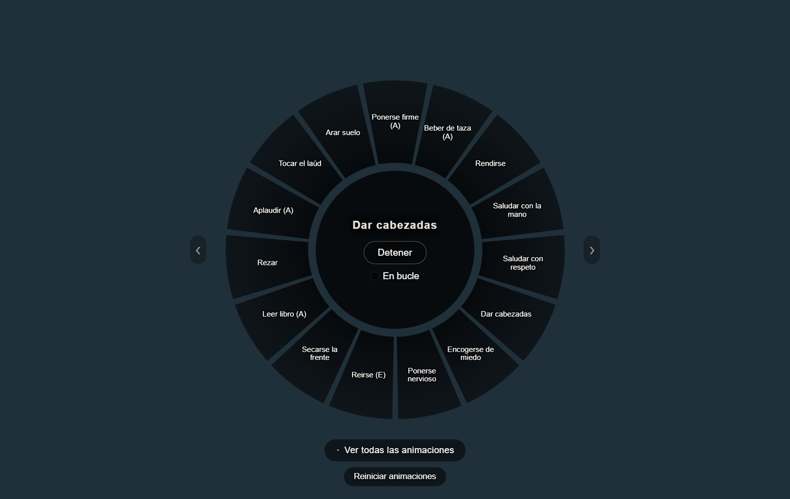

# AnimPlayer

Un reproductor de animaciones para Skyrim dentro de SkyMP. Pulsas **F3** y sale
la rueda de tus favoritos en el centro de la pantalla; debajo, un botón abre la
lista entera, pegada al lado derecho. Escribes lo que buscas, pulsas la
animación y tu personaje la hace. Los demás jugadores la ven.

Una tecla y ya. Sin pestañas ni pasos intermedios, y con el panel cerrado no
hay nada encima del juego.




> Las dos capturas salen de la prueba, no de una captura a mano: se
> rehacen solas cada vez que se pasa la suite.

- **228 animaciones** a la vista, de las 737 que trae el Skyrim instalado.
  Ninguna está escrita a mano: salen de los registros IDLE del propio juego.
- **Todas con nombre y descripción en español**: «Tocar el laúd», no
  `IdleLuteStart`. Y al pasar el ratón, una ficha que cuenta lo que vas a ver.
- **Una rueda de favoritos.** Una estrella en cada fila; lo que marques sale en
  la rueda y se guarda en disco.
- **Diez categorías**, y una animación puede estar en varias: «Rezar en
  cuclillas» es magia y es estar de rodillas.
- **Buscador** por nombre, por palabras en español y por el id del evento:
  escribir `sentarse` encuentra las sillas aunque ninguna se llame así.
- **En bucle**: una casilla que deja la animación repitiéndose hasta que pulsas
  Detener. Sin marcar, se reproduce una sola vez.
- **Detener de verdad**, que no es obvio: Skyrim no tiene un «parar». Hay que
  mandarle cuatro eventos distintos y devolverte a la guardia si la tenías.
- **Preparado para otros mods**: se añaden animaciones sin tocar el código.
- **Llamable desde otros mods**: un mod de bardo puede pedir la animación del
  laúd con una línea, sin saber nada de cómo funciona esto por dentro.
- **El servidor puede esconder animaciones por jugador**, con una llamada.

---

## Instalación

No hay nada que compilar: es JavaScript, SkyrimPlatform lo carga tal cual.

```powershell
.\instalar.ps1
```

Busca el Skyrim con SkyMP instalado y copia los dos archivos de `plugin/` a
`Data\Platform\PluginsDev\`. Si tu Skyrim está en otro sitio:

```powershell
.\instalar.ps1 -Skyrim "D:\Juegos\Skyrim Special Edition"
```

A mano es igual de fácil: copiar `plugin\animplayer.js` y
`plugin\animplayer-settings.txt` a

```
Skyrim Special Edition\Data\Platform\PluginsDev\
```

`PluginsDev` es la carpeta para plugins propios; `Plugins` la gestionan los
lanzadores y lo que pongas ahí te lo pueden borrar.

> **Ojo con el lanzador.** Algunos borran `PluginsDev` al arrancar. Si entras y
> F3 no hace nada, mira si el archivo sigue ahí.

---

## Uso

| | |
|---|---|
| **F3** | abre y cierra el panel |
| **La rueda** | tus favoritos. Pulsa uno y se reproduce |
| **‹ ›** | pasa de grupo cuando tienes más de quince favoritos |
| **Ver todas las animaciones** | abre la lista entera |
| **Escribir** | busca. `saludar`, `laúd`, `IdleWave`, `sentarse`… |
| **Pasar el ratón por una fila** | saca su ficha: nombre y qué hace |
| **Clic en una fila** | la reproduce |
| **Flechas ↑ ↓ y Enter** | elegir y reproducir sin tocar el ratón |
| **Filtro** | abre las categorías |
| **★ La estrella** | guarda en favoritos y lo manda a la rueda |
| **En bucle** | la repite hasta que pulses Detener |
| **Detener** | corta la animación. Si alguna no se corta, púlsalo otra vez |
| **Reiniciar animaciones** | desatasca al personaje: lo saca del mueble, le devuelve el movimiento y la colisión |
| **Esc** | cierra el panel |

Mientras el panel está abierto el personaje no se mueve, para que escribir en la
barra no te haga caminar. La cámara, el combate y los menús siguen funcionando.

Al reproducir se pasa a tercera persona: en primera no se ve el cuerpo y
parecería que la animación no va.

Si pulsas F3 justo al aparecer en el mundo, el panel no se abre en el momento:
se espera a que el mundo termine de asentarse (unos 15 segundos desde que se
cierra la pantalla de carga) y se abre solo. Abrir paneles antes cuelga el
juego, y es algo que el mod de inventario del servidor ya documenta en su
código.

### Por qué F3

Es la única tecla de función libre en este servidor:

| | |
|---|---|
| F2 | el inventario del servidor |
| F4 | esconde la interfaz de SkyMP |
| F5 / F9 | guardado y carga rápidos de Skyrim |
| F6 | cambia el foco del navegador |
| F12 | la captura de pantalla de Steam |

Se puede cambiar en `animplayer-settings.txt`, pero si pones una de esas, las
dos cosas pasarán a la vez.

---

## Las 228 son las revisadas, no todas las que hay

El juego trae 737 animaciones que se le pueden aplicar al jugador. No todas
sirven: hay 109 golpes de gracia, decenas que el juego usa él solo mientras
juegas, unas cuantas que dejan al personaje tirado en el suelo, y otras que
necesitan un mueble delante y sin él te dejan flotando en el aire.

Así que están **todas revisadas una a una, en el juego**, en una hoja de
cálculo. Lo que decide si una animación se ve es su columna `estado`: Aceptado
se ve, cualquier otra cosa no. Nada más — ni reglas, ni excepciones.

Las escondidas no desaparecen: siguen en el catálogo, el servidor las puede
lanzar, y en el buscador salen escribiendo `#hidden` delante de lo que busques.

Cómo funciona ese circuito —bajar la hoja, pulirla, volver a subirla— está en
[docs/la-hoja.md](docs/la-hoja.md).

---

## Los nombres están en español

El juego no los trae así: los suyos son los identificadores de editor de
Bethesda (`IdleWarmHandsStanding`), en inglés y **a veces directamente mal
puestos** — el de `IdleKneeling` dice *CheckCorpse*, el de `blockStart` dice
*BowZoom*. El editorId no coincide con el nombre del evento en 456 de las 737,
así que traducirlo al pie de la letra habría dado nombres falsos.

La primera pasada la hace
[herramientas/traducciones.py](herramientas/traducciones.py) mirando el
**nombre del evento**, que es lo único que no miente. Pero el nombre bueno sale
de haber visto la animación, y eso es lo que está escrito en la hoja.

El id no se pierde: entra en las palabras de búsqueda, así que buscar
`IdleWave` sigue funcionando. Lo que ya no hace es salir por pantalla — es dato
técnico y quien juega no tiene por qué verlo.

---

## Los favoritos se guardan en disco

No en `localStorage`. Esta página la dibuja el navegador que SkyrimPlatform
monta encima del juego, y ese no garantiza que su almacenamiento sobreviva a
cerrar Skyrim; unos favoritos que se borran cada vez que cierras el juego no son
favoritos.

Se guardan con las dos funciones que SkyrimPlatform da para eso, y que el propio
cliente de SkyMP usa para recordar tu sesión:

```js
sp.writePlugin('animplayer-favoritos', '//' + JSON.stringify(lista), 'PluginsNoLoad')
sp.getPluginSourceCode('animplayer-favoritos', 'PluginsNoLoad')
```

El archivo acaba en `Data\Platform\PluginsNoLoad\`, que es la carpeta de la
que SkyrimPlatform **no** carga nada: su sitio para datos.

---

## Detener no es tan simple como parece

Skyrim no tiene una función de «parar la animación». Lo que hay son eventos
genéricos de parada en el grafo del personaje, y hacen cosas distintas:

```
OffsetStop          la pose que va encima de la postura
AnimObjectStop      lo que el juego te pone en la mano: la copa, la jarra, el libro
IdleFurnitureExit   te saca de la silla  (solo si no estás en una)
IdleStop            y el idle en sí
```

Los cuatro, en ese orden. Dos cosas aprendidas a base de romperlo:

**No se manda `IdleForceDefaultState`.** Su registro IDLE se llama *ResetRoot*:
no para la animación, devuelve la raíz del grafo a su estado por defecto —de
pie, manos vacías, fuera de cualquier mueble—. Se llevaba por delante la
guardia y la silla.

**Con el arma fuera no se manda `AnimObjectStop`.** El arma pasa por el mismo
sistema que la copa del brindis: en el grafo están `AnimObjectDrawBlade`,
`AnimObjectIronSword`, `AnimObjectEquip`. Soltar «lo de la mano» soltaba también
la espada. Y detrás del corte, si el arma sigue fuera, se manda
`combatStanceStart` para devolverte a la guardia: con el arma desenvainada tu
sitio no es «de pie con las manos vacías».

Y si aun así alguna no se para —las hay que meten al personaje en un subgrafo
sin salida propia— **pulsa Detener otra vez** y el corte va a por todas.

---

## Cómo está hecho

Seis capas, de dentro hacia fuera. Están separadas a propósito, sobre todo las
dos primeras.

| Capa | Qué es |
|---|---|
| **Catálogo** | Los datos: qué animaciones hay. Se genera desde el Skyrim instalado. |
| **Reproductor** | Lo único que toca el juego. Una función para reproducir, una para parar. |
| **Transporte** | A dónde va una petición: aquí mismo, o al servidor. |
| **Interfaz** | El panel. Vive en la página del navegador de SkyMP, no en el plugin. |
| **Pegamento** | La tecla, el foco, los mensajes de la página y la cola de acciones. |
| **La puerta** | Lo que otros mods pueden llamar. |

Todo lo que quiera una animación pasa por **una sola puerta**,
`pedirAnimacion(peticion)`, y la petición es un objeto plano:

```js
{ evento: "IdleWave", quien: 0x14, origen: "interfaz" }
```

Plano y serializable a propósito: es exactamente lo que se mandará por la red el
día que las animaciones las reparta el servidor. Cambiar de camino es cambiar el
transporte; ni la interfaz ni el reproductor se enteran.

Más detalle en [docs/arquitectura.md](docs/arquitectura.md).

---

## Llamarlo desde otro mod

```js
var ap = skyrimPlatform.storage.AnimPlayer;
if (ap) ap.reproducir('IdleLuteStart', { bucle: true, origen: 'bardo' });
```

Se publica en `skyrimPlatform.storage`, que es el objeto que SkyrimPlatform
comparte entre plugins y donde el propio cliente de SkyMP deja lo que otros
tienen que poder tocar.

Además de reproducir y parar, se puede buscar en el catálogo, poner y quitar el
bucle, esconder y mostrar animaciones por jugador, registrar animaciones propias
en caliente (salen en el panel al momento, sin tocar ningún archivo) y escuchar
lo que se va reproduciendo.

Dos reglas: míralo en el momento de usarlo y no al cargar tu plugin (el orden de
carga no está garantizado), y ten en cuenta que todo se encola hasta el
siguiente `update`, para que se pueda llamar desde cualquier sitio sin que el
juego se queje.

El manual entero, con un ejemplo completo de mod de bardo, en
[docs/api.md](docs/api.md).

---

## La sincronización entre jugadores sale gratis

No hay que mandar nada al servidor: el cliente de SkyMP tiene un enganche en
`sendAnimationEvent`, ve el evento que acabamos de mandar y lo reenvía él.

Hay excepciones —22 animaciones que SkyMP no reenvía—, y el panel las marca en
la lista con un «·solo tú» en vez de dejar un botón que parece roto. Están
explicadas una a una en [docs/sincronizacion.md](docs/sincronizacion.md).

---

## Añadir animaciones de otros mods

Sin tocar el código: se ponen en la lista `animaciones` de
`animplayer-settings.txt`.

```json
"animaciones": [
  { "evento": "MiModSaludoElegante", "nombre": "Saludo elegante",
    "categoria": "gestos", "busqueda": "saludar reverencia", "destacada": true }
]
```

Lo único obligatorio es `evento`. Cómo se averigua el nombre del evento de un
mod está en [docs/anadir-animaciones.md](docs/anadir-animaciones.md), y hay
ejemplos en [catalogo/ejemplo-mod.json](catalogo/ejemplo-mod.json).

---

## Regenerar el catálogo

El catálogo no se escribe a mano. Sale de los registros IDLE del Skyrim que
tengas instalado, que es donde está el nombre real de cada evento, cruzado con
lo que esté escrito en la hoja de revisión.

```bash
python herramientas/pulir-hoja.py          # la hoja -> catalogo/hoja-pulida.csv
python herramientas/generar-catalogo.py    # juego + hoja -> catalogo/vanilla.json
python herramientas/generar-plugin.py      # lo mete dentro de plugin/animplayer.js
```

Si tienes Skyrim en otro sitio, se le pasa la ruta de su `Data`.

Las herramientas incluyen un lector de BSA y un descompresor LZ4 en Python puro,
porque los archivos del juego van comprimidos y no hacía falta añadir
dependencias para leer unos cuantos nombres.

---

## Pruebas

```bash
node pruebas/ejecutar.js
```

Se carga el plugin **de verdad**, sin tocarlo, contra un SkyrimPlatform de
mentira. El plugin, creyéndose dentro del juego, manda a la página el código de
su panel; la prueba coge ese mismo texto y lo inyecta en un Chromium de verdad.
Luego maneja el panel como lo haría una persona y comprueba que el plugin acaba
llamando a `Debug.sendAnimationEvent` con el evento correcto.

Se prueba la cadena entera: interfaz → mensaje → cola → reproductor, y también
la puerta para otros mods, llamándola igual que lo haría el mod del bardo. **350
comprobaciones.**

Buena parte son de cosas que ya se rompieron una vez: que «En guardia» encadene
sin bajar las manos, que la lista no dé un salto al pulsar, que buscar «en
guardia» encuentre las que llevan paréntesis, que los contadores digan lo que se
ve y no el total.

Lo que **no** se puede probar así, y hay que mirar dentro del juego:

- que Havok mueva de verdad el cuerpo,
- que los demás jugadores la vean,
- que la tecla llegue (`buttonEvent` no siempre se porta igual).

---

## Estructura

```
plugin/
  animplayer.js              el mod entero, un solo archivo
  animplayer-settings.txt    ajustes, documentados dentro
catalogo/
  vanilla.json               generado: juego + hoja
  revisado.csv               la hoja de revisión, 737 filas
  hoja-pulida.csv            la hoja lista para volver a subir
  ejemplo-mod.json           cómo añadir las de otros mods
herramientas/
  pulir-hoja.py              infinitivos, letras y descripciones
  descripciones.py           las frases escritas a mano
  estados.py                 correcciones de estado que no se pierden
  categorias.py              a qué categorías va cada una, por el nombre
  generar-catalogo.py        lee los IDLE del juego y cruza con la hoja
  generar-plugin.py          mete el catálogo en el plugin
  traducciones.py            la primera pasada de nombres al español
  neutral.py                 español neutral: «olla», no «puchero»
  estilo.py                  nombres en infinitivo y sinónimos unificados
  dependencias.py            qué estado necesita el jugador
  descartes.py               qué se descarta por familias, y por qué
  decisiones.py              las excepciones que salieron de probarlas
  hoja-completa.py           genera la hoja desde cero
  idles.py                   lector de registros IDLE de esm/esp
  bsa.py                     lector de BSA de Skyrim
  lz4puro.py                 descompresor LZ4 en Python puro
docs/
  arquitectura.md            las seis capas y por qué
  la-hoja.md                 el circuito de la hoja de revisión
  api.md                     llamar a AnimPlayer desde otro mod
  sincronizacion.md          cómo sincroniza SkyMP y qué no sincroniza
  anadir-animaciones.md      añadir animaciones de otros mods
pruebas/
  ejecutar.js                lanza la prueba
  prueba-panel.js            la prueba
  sp-falso.js                el SkyrimPlatform de mentira
instalar.ps1
```
