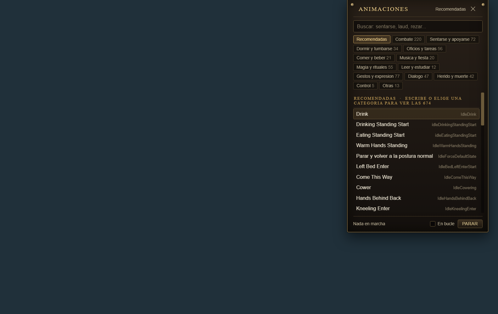

# AnimPlayer

Un reproductor de animaciones para Skyrim dentro de SkyMP. Pulsas **F3** y se
descuelga, ya abierta, la lista en la esquina de arriba a la derecha: escribes
lo que buscas, pulsas la animación y tu personaje la hace. Los demás jugadores
la ven.

Una tecla y la lista. Sin pestañas ni pasos intermedios, y con el panel cerrado
no hay nada encima del juego.



- **674 animaciones**, sacadas del propio Skyrim instalado, no escritas a mano.
- **Todas con nombre en español**: «Tocar el laúd», no `IdleLuteStart`.
- **Favoritos**: una estrella en cada fila. Lo que marques se guarda en disco,
  sale en su propia categoría y aparece siempre el primero al buscar.
- **Buscador** por nombre, por nombre del evento y por palabras en español:
  escribir `sentarse` encuentra las sillas aunque ninguna se llame así.
- **Categorías** con su cuenta: gestos, sentarse, oficios, comer, música,
  magia, dormir, diálogo, herido, combate…
- **En bucle**: una casilla que deja la animación repitiéndose hasta que pulsas
  Parar. Sin marcar, se reproduce una sola vez.
- **Preparado para otros mods**: se añaden animaciones sin tocar el código.
- **Llamable desde otros mods**: un mod de bardo puede pedir la animación del
  laúd con una línea, sin saber nada de cómo funciona esto por dentro.
- **Preparado para que lo lleve el servidor**: reproducir está aislado en su
  propia capa, y la petición es un objeto plano listo para mandar por la red.

---

## Instalación

No hay nada que compilar: es JavaScript, SkyrimPlatform lo carga tal cual.

```powershell
.\instalar.ps1
```

Busca el Skyrim con SkyMP instalado y copia los dos archivos de `plugin/` a
`Data\Platform\PluginsDev\`. Si tu Skyrim está en otro sitio:

```powershell
.\instalar.ps1 -Skyrim "D:\Juegos\Skyrim Special Edition"
```

A mano es igual de fácil: copiar `plugin\animplayer.js` y
`plugin\animplayer-settings.txt` a

```
Skyrim Special Edition\Data\Platform\PluginsDev\
```

`PluginsDev` es la carpeta para plugins propios; `Plugins` la gestionan los
lanzadores y lo que pongas ahí te lo pueden borrar.

---

## Uso

| | |
|---|---|
| **F3** | abre y cierra el panel |
| **Escribir** | busca. `saludar`, `lute`, `IdleWave`, `chair front`… |
| **Flechas ↑ ↓ y Enter** | elegir y reproducir sin tocar el ratón |
| **Clic en una fila** | la reproduce |
| **En bucle** | la repite hasta que pulses Parar |
| **★ La estrella** | guarda en favoritos. Se enciende en dorado |
| **Parar** | corta la animación y levanta de la silla o la cama |
| **Esc** | cierra el panel |

Mientras el panel está abierto el personaje no se mueve, para que escribir en la
barra no te haga caminar. La cámara, el combate y los menús siguen funcionando.

Al reproducir se pasa a tercera persona: en primera no se ve el cuerpo y
parecería que la animación no va.

Si pulsas F3 justo al aparecer en el mundo, el panel no se abre en el momento:
se espera a que el mundo termine de asentarse (unos 15 segundos desde que se
cierra la pantalla de carga) y se abre solo. Abrir paneles antes cuelga el
juego, y es algo que el mod de inventario del servidor ya documenta en su
código.

### Por qué F3

Es la única tecla de función libre en este servidor:

| | |
|---|---|
| F2 | el inventario del servidor |
| F4 | esconde la interfaz de SkyMP |
| F5 / F9 | guardado y carga rápidos de Skyrim |
| F6 | cambia el foco del navegador |
| F12 | la captura de pantalla de Steam |

Se puede cambiar en `animplayer-settings.txt`, pero si pones una de esas, las
dos cosas pasarán a la vez.

---

## Los nombres están en español

El juego no los trae así: los suyos son los identificadores de editor de
Bethesda (`IdleWarmHandsStanding`), en inglés y a veces directamente mal
puestos — el de `IdleKneeling` dice *CheckCorpse*, el de `blockStart` dice
*BowZoom*. Se traducen a mano en
[herramientas/traducciones.py](herramientas/traducciones.py), mirando el
**nombre del evento**, que es lo único que no miente.

Los ochenta y pico golpes de gracia (`pa_KillMove...`) se montan con reglas,
que siguen todos el mismo patrón: arma, criatura, golpe y variante.

El nombre original no se pierde: entra en las palabras de búsqueda, así que
buscar `chair` sigue encontrando las sillas, y el nombre del evento se ve
siempre a la derecha de cada fila.

---

## Los favoritos se guardan en disco

No en `localStorage`. Esta página la dibuja el navegador que SkyrimPlatform
monta encima del juego, y ese no garantiza que su almacenamiento sobreviva a
cerrar Skyrim; unos favoritos que se borran cada vez que cierras el juego no son
favoritos.

Se guardan con las dos funciones que SkyrimPlatform da para eso, y que el propio
cliente de SkyMP usa para recordar tu sesión:

```js
sp.writePlugin('animplayer-favoritos', '//' + JSON.stringify(lista), 'PluginsNoLoad')
sp.getPluginSourceCode('animplayer-favoritos', 'PluginsNoLoad')
```

El archivo acaba en `Data\Platform\PluginsNoLoad\`, que es la carpeta de la
que SkyrimPlatform **no** carga nada: su sitio para datos.

---

## Cómo está hecho

Seis capas, de dentro hacia fuera. Están separadas a propósito, sobre todo las
dos primeras.

| Capa | Qué es |
|---|---|
| **Catálogo** | Los datos: qué animaciones hay. Se genera desde el Skyrim instalado. |
| **Reproductor** | Lo único que toca el juego. Una función para reproducir, una para parar. |
| **Transporte** | A dónde va una petición: aquí mismo, o al servidor. |
| **Interfaz** | El panel. Vive en la página del navegador de SkyMP, no en el plugin. |
| **Pegamento** | La tecla, el foco, los mensajes de la página y la cola de acciones. |
| **La puerta** | Lo que otros mods pueden llamar. |

Todo lo que quiera una animación pasa por **una sola puerta**,
`pedirAnimacion(peticion)`, y la petición es un objeto plano:

```js
{ evento: "IdleWave", quien: 0x14, origen: "interfaz" }
```

Plano y serializable a propósito: es exactamente lo que se mandará por la red el
día que las animaciones las reparta el servidor. Cambiar de camino es cambiar el
transporte; ni la interfaz ni el reproductor se enteran.

Más detalle en [docs/arquitectura.md](docs/arquitectura.md).

---

## Llamarlo desde otro mod

```js
var ap = skyrimPlatform.storage.AnimPlayer;
if (ap) ap.reproducir('IdleLuteStart', { bucle: true, origen: 'bardo' });
```

Se publica en `skyrimPlatform.storage`, que es el objeto que SkyrimPlatform
comparte entre plugins y donde el propio cliente de SkyMP deja lo que otros
tienen que poder tocar.

Además de reproducir y parar, se puede buscar en el catálogo, poner y quitar el
bucle, registrar animaciones propias en caliente (salen en el panel al momento,
sin tocar ningún archivo) y escuchar lo que se va reproduciendo.

Dos reglas: míralo en el momento de usarlo y no al cargar tu plugin (el orden de
carga no está garantizado), y ten en cuenta que todo se encola hasta el
siguiente `update`, para que se pueda llamar desde cualquier sitio sin que el
juego se queje.

El manual entero, con un ejemplo completo de mod de bardo, en
[docs/api.md](docs/api.md).

---

## La sincronización entre jugadores sale gratis

No hay que mandar nada al servidor: el cliente de SkyMP tiene un enganche en
`sendAnimationEvent`, ve el evento que acabamos de mandar y lo reenvía él.

Hay excepciones, y el panel las marca en la lista con un aviso en vez de dejar
un botón que parece roto. Están explicadas una a una en
[docs/sincronizacion.md](docs/sincronizacion.md).

---

## Añadir animaciones de otros mods

Sin tocar el código: se ponen en la lista `animaciones` de
`animplayer-settings.txt`.

```json
"animaciones": [
  { "evento": "MiModSaludoElegante", "nombre": "Saludo elegante",
    "categoria": "gestos", "busqueda": "saludar reverencia", "destacada": true }
]
```

Lo único obligatorio es `evento`. Cómo se averigua el nombre del evento de un
mod está en [docs/anadir-animaciones.md](docs/anadir-animaciones.md), y hay
ejemplos en [catalogo/ejemplo-mod.json](catalogo/ejemplo-mod.json).

---

## Regenerar el catálogo

El catálogo no se escribe a mano. Sale de los registros IDLE del Skyrim que
tengas instalado, que es donde está el nombre real de cada evento.

```bash
python herramientas/generar-catalogo.py     # lee el juego -> catalogo/vanilla.json
python herramientas/generar-plugin.py       # lo mete dentro de plugin/animplayer.js
```

Si tienes Skyrim en otro sitio, se le pasa la ruta de su `Data`.

Las herramientas incluyen un lector de BSA y un descompresor LZ4 en Python puro,
porque los archivos del juego van comprimidos y no hacía falta añadir
dependencias para leer unos cuantos nombres.

---

## Pruebas

```bash
node pruebas/ejecutar.js
```

Se carga el plugin **de verdad**, sin tocarlo, contra un SkyrimPlatform de
mentira. El plugin, creyéndose dentro del juego, manda a la página el código de
su panel; la prueba coge ese mismo texto y lo inyecta en un Chromium de verdad.
Luego maneja el panel como lo haría una persona y comprueba que el plugin acaba
llamando a `Debug.sendAnimationEvent` con el evento correcto.

Se prueba la cadena entera: interfaz → mensaje → cola → reproductor, y también
la puerta para otros mods, llamándola igual que lo haría el mod del bardo. Unas
ciento veinte comprobaciones.

Lo que **no** se puede probar así, y hay que mirar dentro del juego:

- que Havok mueva de verdad el cuerpo,
- que los demás jugadores la vean,
- que la tecla llegue (`buttonEvent` no siempre se porta igual).

---

## Estructura

```
plugin/
  animplayer.js              el mod entero, un solo archivo
  animplayer-settings.txt    ajustes, documentados dentro
catalogo/
  vanilla.json               generado desde el juego
  ejemplo-mod.json           cómo añadir las de otros mods
herramientas/
  traducciones.py            los nombres en español
  generar-catalogo.py        lee los IDLE del juego
  generar-plugin.py          mete el catálogo en el plugin
  idles.py                   lector de registros IDLE de esm/esp
  bsa.py                     lector de BSA de Skyrim
  lz4puro.py                 descompresor LZ4 en Python puro
docs/
  api.md                     llamar a AnimPlayer desde otro mod
  arquitectura.md            las seis capas y por qué
  sincronizacion.md          cómo sincroniza SkyMP y qué no sincroniza
  anadir-animaciones.md      añadir animaciones de otros mods
pruebas/
  ejecutar.js                lanza la prueba
  prueba-panel.js            la prueba
  sp-falso.js                el SkyrimPlatform de mentira
instalar.ps1
```
